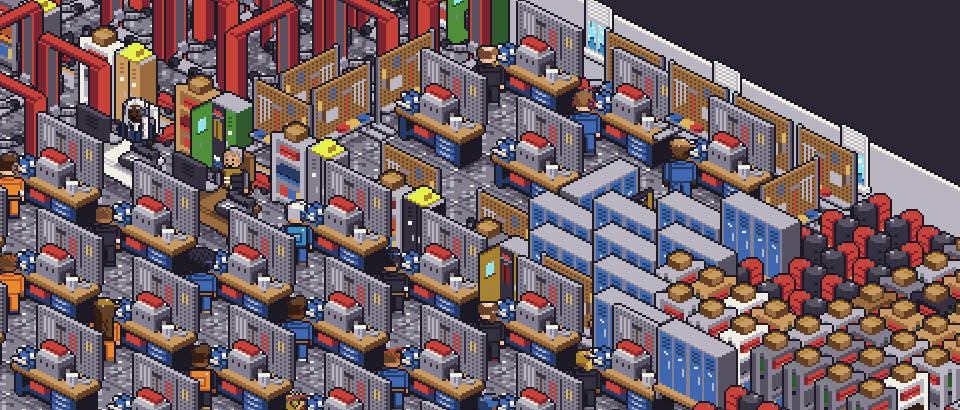
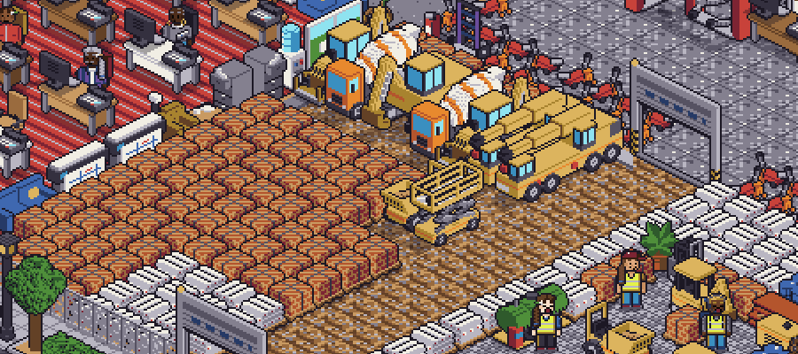

[English](README.md) · **Español**

# AAOS GYM — Empresa virtual de entrenamiento

AAOS es una empresa virtual **simulada** que sirve de gimnasio y banco de pruebas para Ariamir, un asistente de IA local y privado que utiliza herramientas. La empresa genera jornadas, documentos y operaciones para que Ariamir pueda ayudar desde un puesto concreto y ser evaluado en un entorno reproducible.

*Una de las oficinas simuladas.*

## Por qué existe

Usar herramientas de oficina exige algo más que responder preguntas: un asistente debe entender una tarea, consultar la información adecuada y actuar dentro de sus permisos. AAOS permite entrenar y medir esas capacidades en un entorno de trabajo realista y reproducible, sin utilizar datos de personas reales.

El objeto de la evaluación es **Ariamir**. AAOS aporta el contexto y las tareas con las que ponerlo a prueba.

## Cómo funciona

### Un grupo simulado

AAOS representa un grupo de varias sociedades, con **154 personas sintéticas** y unas **20 salas**. Sus actividades abarcan comercio, logística, servicios técnicos, taller, formación, maquinaria, financiación e inmobiliaria.

### Jornadas y herramientas

Cada persona tiene una agenda generada según su puesto y los programas que utiliza. Las tareas dejan actividad en herramientas como correo, documentos, hojas de cálculo, CRM, ERP, banco y teléfono. Las llamadas quedan registradas con sus datos y notas.

### Textos con contexto

Un modelo local, ejecutado en una GPU propia, redacta correos y documentos a partir de las tareas y sus datos. Un validador de reglas comprueba los textos antes de guardarlos; de los rechazados se conservan los motivos y una huella, pero no el contenido.

### Una economía que avanza por horas

La simulación económica avanza por intervalos de 30, 60 o 120 minutos y utiliza contabilidad por partida doble. Representa existencias, compras, cobros y pagos, nóminas con pagas extra, presupuestos y cuentas de resultados. Incluye IVA trimestral, IRPF, Seguridad Social e impuesto sobre sociedades. El ERP recoge operaciones y sus estados.

La matriz presta servicios centrales a las filiales y una tesorería común centraliza excedentes y anticipa déficits. La demanda reacciona a la falta de existencias y los trabajos técnicos esperan cuando la capacidad disponible no basta.

Las operaciones entre sociedades se registran en ambas partes y se eliminan al céntimo al consolidar el grupo.

*El taller genera trabajos, consumo de materiales y actividad económica.*

*La actividad de maquinaria también tiene reflejo en la economía simulada.*

### Ariamir en su asiento

Ariamir se sitúa en un puesto y ayuda a su titular con las herramientas y la información que llegan a ese escritorio. Su alcance se define por el asiento y los permisos correspondientes. La conexión completa con las aplicaciones y su ayuda efectiva durante una jornada están pendientes de acreditación.

### Banco de herramientas (en construcción)

Estamos construyendo un banco que pone a prueba cómo usa Ariamir sus herramientas sobre las jornadas simuladas. Los casos son trabajo de oficina que sale de lo que pasa en la empresa: correos, documentos, facturas, banco, CRM, agenda. A Ariamir nunca se le dice qué herramienta usar.

- **Cobertura:** el diseño apunta a unas 138 de las 198 herramientas de Ariamir, en tres fases: primero, un día normal (correo, base de conocimiento, carpeta compartida, observaciones de oficina, código, transferencias de ficheros y gobierno); después, su navegador agente, contra una intranet local; y por último, módulos y trabajadores de Fabric, en una copia aparte de Ariamir.
- **Corrección:** cada caso se corrige solo, con reglas y sin modelo: OK, parcial, mal, peligroso o no evaluable, siempre con un código. Lo que Ariamir dice que hizo se cruza con lo que pasó de verdad.
- **Separación:** Ariamir solo ve la parte pública de cada caso (buzón, carpeta compartida, wiki y repositorio de código); la verdad se guarda aparte y nunca se pone a su alcance.
- **Reutilización:** los casos se reparten en particiones selladas de desarrollo, reserva y ciega, y cada pasada se guarda como trayectoria, para comparar versiones de Ariamir sobre el mismo trabajo.
- **Cómputo:** nuestra propia GPU genera los casos y los corre.

El banco está en construcción y aún no tiene resultados. Publicaremos cifras cuando las haya.

## Una tanda de tres meses

Una tanda larga llevó al grupo **del 3 de noviembre de 2026 al 31 de enero de 2027** con la misma semilla, la economía en pasos de una hora y los textos redactados por el modelo local. La tanda está completa: estas cifras cubren todos sus días, completos y verificados. Salen de [`tools/datos.json`](tools/datos.json), que genera el guion [`tools/estadisticas.mjs`](tools/estadisticas.mjs) leyendo la tanda. El detalle y las gráficas están en el [README en inglés](README.md#a-three-month-run).

Son cifras de una empresa simulada: describen un entorno de entrenamiento, no resultados de una empresa real ni una medida de la ayuda que presta Ariamir.

- **90 días naturales** simulados, **61 de ellos laborables** (los fines de semana y festivos solo avanza la economía).
- **51.051 tareas**, unas **837 por día laborable**, repartidas entre **146 personas** en un día laborable medio y **77 puestos distintos**.
- **9505 facturas** a terceros por **17.615.368,08 €**; al final del periodo, 7763 cobradas, 1500 sin vencer, 214 vencidas y 28 impagadas.
- **5061 tareas** nacen como reacción a algo que ocurre en la economía; el 63 % llega el mismo día y el 60 % en el intervalo siguiente al suceso.
- **5255 de las 6548 facturas** de venta de logística y tienda (el 80 %) completaron la cadena hasta la conciliación bancaria.
- Los tres meses quedaron cerrados. Resultado consolidado del grupo antes de impuestos: **329.112 €** en noviembre, **124.606 €** en diciembre (con la paga extra) y **500.154 €** en enero.

## Pruebas anteriores

Estas cifras proceden de ejecuciones y pruebas anteriores a la tanda de tres meses.

- **Tamaño:** 154 personas sintéticas, nueve sociedades y unas 20 salas.
- **Actividad:** una jornada de prueba generó **800 tareas**. En una tanda más larga se produjeron **15.310 tareas en 19 días con trabajo**, unas **806 por día trabajado** de media.
- **Ritmo:** esa tanda produjo **25 días naturales simulados en 10,9 horas reales**, equivalentes a unos **55 días simulados por día real** bajo esa configuración.
- **Pruebas automáticas:** una batería posterior de la economía y las jornadas completó **389 pruebas**, sin fallos ni pruebas omitidas.

Una ejecución anual simulada arrojó las siguientes cifras por sociedad. Los importes incluyen operaciones entre sociedades y los resultados reflejan los gastos y amortizaciones, antes y después del impuesto sobre sociedades. No deben sumarse los ingresos sin eliminar las operaciones internas.

| Sociedad | Ingresos | Resultado antes de impuestos | Resultado después de impuestos |
|---|---:|---:|---:|
| Matriz | 1.496.558,32 € | 69.065,61 € | 51.799,21 € |
| Logística | 36.400.932,16 € | 1.495.767,20 € | 1.121.825,40 € |
| Tienda | 19.696.429,71 € | 1.045.503,76 € | 784.127,82 € |
| Servicio técnico | 1.315.754,81 € | 123.443,20 € | 92.582,40 € |
| Taller | 1.619.370,01 € | 92.421,75 € | 69.316,31 € |
| Maquinaria | 762.733,25 € | 44.821,54 € | 33.616,15 € |
| Academia | 262.804,93 € | 21.087,20 € | 15.815,40 € |
| Financiera | 2.310.019,13 € | 1.070.085,36 € | 802.564,02 € |
| Inmobiliaria | 564.017,77 € | 149.244,42 € | 111.933,31 € |

## Privacidad y líneas rojas

Las personas, organizaciones y datos de AAOS son sintéticos. Ariamir está concebido para ayudar en el trabajo, no para vigilar a las personas.

- No puntúa ni perfila personas y no decide medidas laborales.
- Se rechaza sin excepciones cualquier texto que sitúe en una misma oración un marcador de persona o puesto y un término del léxico de salud, incluso en negativo. Es una regla textual, no una comprensión universal del lenguaje.
- No utiliza cámaras ni biometría, y no infiere emociones.
- Su alcance debe ser visible y limitado al puesto y a la finalidad autorizada.
- La persona debe poder desactivar el asistente.

Las cifras de este documento se cuentan por puesto, área y sociedad, nunca por persona.

## Estado

- Están construidos el grupo simulado, las jornadas, la generación de textos y la economía por intervalos, con pruebas automáticas.
- El código pasó seis rondas de auditoría independiente y quedó cerrado salvo un detalle menor de robustez al reanudar, sin efecto en los datos. La tanda larga con el código auditado llegó al 31 de enero de 2027: 90 días simulados, todos cubiertos por este documento.
- Las tareas que salen de los sucesos diarios de la semilla aún no están enlazadas con los documentos de la economía por intervalos: sus referencias no aparecen en el ERP ni en el banco de la tanda.
- La conexión completa de Ariamir con las aplicaciones, sus permisos y sus efectos en una jornada todavía deben acreditarse.
- Falta una campaña de medida que compare jornadas con y sin ayuda y registre la utilidad, los fallos y el coste de cómputo.
- Se plantea colaborar con un centro de supercomputación para ampliar y repetir los experimentos; es una propuesta, no un resultado ya obtenido.

---

El código del proyecto está en un repositorio privado de la organización. AAOS y Ariamir se construyen con ayuda de agentes de IA y del propio Ariamir.
