<!-- Generated by tools/estadisticas.mjs --lang en (tools/readme-en.mjs) from tools/datos.json. Edit tools/readme-en.mjs, not this file. -->

**English** · [Español](README.es.md)

# AAOS GYM — A virtual training company

AAOS is a **simulated** company that serves as a gym and test bench for Ariamir, a local, private AI assistant that uses tools. The company generates working days, documents and transactions so that Ariamir can help from a specific desk and be evaluated in a reproducible environment.


*One of the simulated offices.*

## Why it exists

Using office tools takes more than answering questions: an assistant has to understand a task, look up the right information and act within its permissions. AAOS makes it possible to train and measure those skills in a realistic, reproducible workplace, without using anyone's real data.

What is being evaluated is **Ariamir**. AAOS provides the context and the tasks to test it with.

## How it works

### A simulated group

AAOS represents a group of several companies, with **154 synthetic people** and about **20 rooms**. Its activities cover retail, logistics, field service, a workshop, training, machinery rental, finance and real estate.

### Working days and tools

Each person has a schedule generated from their role and the software they use. Tasks leave a trace in tools such as email, documents, spreadsheets, CRM, ERP, bank and phone. Calls are logged with their details and notes.

### Texts with context

A local model, running on our own GPU, writes emails and documents from the tasks and their data. A rule-based validator checks the texts before they are saved; for rejected texts, the reasons and a fingerprint are kept, but not the content.

### An economy that moves hour by hour

The economic simulation advances in steps of 30, 60 or 120 minutes and uses double-entry accounting. It covers inventory, purchasing, collections and payments, payroll with extra pay, budgets and income statements. It includes quarterly VAT, income tax withholding, Social Security and corporate income tax. The ERP records transactions and their status.

The holding company provides central services to the subsidiaries, and a shared cash pool collects surpluses and advances cash to cover shortfalls. Demand reacts to stock shortages, and technical jobs wait when there is not enough capacity.

Transactions between companies are recorded on both sides and eliminated to the cent when the group is consolidated.


*The workshop generates jobs, material use and economic activity.*


*Machinery activity is also reflected in the simulated economy.*

### Ariamir at its desk

Ariamir is designed to sit at one desk and help the person in that role with the tools and information that reach that desk. Its scope is set by the seat and its permissions. Its full connection to the apps and its actual help during a working day have yet to be verified.

### Tool bench (in progress)

We are building a bench that tests how Ariamir uses its tools on the simulated working days. The cases are office work that comes out of what happens in the company: emails, documents, invoices, the bank, the CRM, the calendar. Ariamir is never told which tool to use.

- **Coverage:** the design aims at about 138 of Ariamir's 198 tools, in three phases: first an ordinary working day (email, the knowledge base, the shared folder, office observations, code, file transfers and governance); then its browser agent, against a local intranet; and finally modules and Fabric workers, on a separate copy of Ariamir.
- **Grading:** every case is graded automatically, by rules and with no model: OK, partial, wrong, dangerous or not evaluable, always with a reason code. What Ariamir says it did is checked against what actually happened.
- **Separation:** Ariamir only sees the public side of each case (mailbox, shared folder, wiki and code repository); the ground truth is kept apart and is never made available to it.
- **Reuse:** the cases are split into sealed development, holdout and blind sets, and every run is saved as a trajectory, so different versions of Ariamir can be compared on the same work.
- **Compute:** our own GPU generates the cases and runs them.

The bench is under construction and has no results yet. We will publish figures when there are some.

## A three-month run

A long run takes the group **from 3 November 2026 to 31 January 2027** with the same seed, the economy in one-hour steps and the texts written by the local model. The run is complete: **the figures in this section cover every day up to 31 January 2027**, all complete and verified. All of them come from [`tools/datos.json`](tools/datos.json), which the script [`tools/estadisticas.mjs`](tools/estadisticas.mjs) generates by reading the run.

These figures describe a simulated company: they are a training environment, not results from a real company or a measure of the help Ariamir provides.

- **90 calendar days** simulated, **61 of them working days** (at weekends and on holidays only the economy runs).
- **51,051 tasks**, about **837 per working day**, spread across **146 people** on an average working day and **77 different roles**.
- **18,700 emails** (12,691 internal and 6,009 to customers and suppliers), **19,945 documents**, **6,418 spreadsheets**, **4,058 logged calls**, **1,930 CRM activities** and **17,793 bank transactions**.
- **9,505 invoices** to third parties worth **€17,615,368.08**; at the end of the period, 7,763 have been collected, 1,500 are not yet due, 214 are overdue and 28 are unpaid.
- **5,061 tasks** arise in reaction to something that happens in the economy; 63% arrive on the same day and 60% in the tick right after the event.

### The work of each day

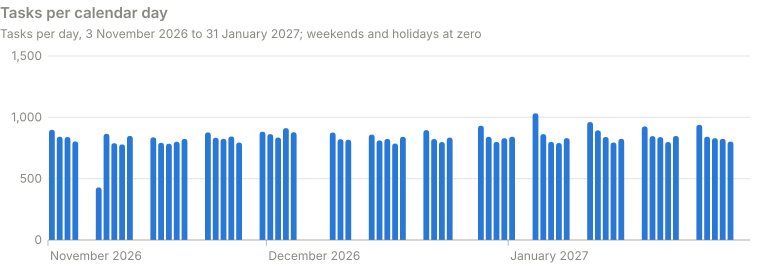

November had 20 working days and 16,193 tasks; December, 20 and 16,885; January, 21 and 17,973. On the quietest working day, 9 November, only 87 people worked and there were 429 tasks, because it was a holiday at some of the sites.

Of the 51,051 tasks, **41,502** are routine work for the role (coordination emails, work reports, control sheets, calls), **4,488** come from the day's events (orders, service calls, supplier invoices, transactions) and **5,061** react to the economy tick by tick.

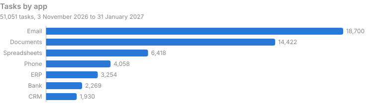

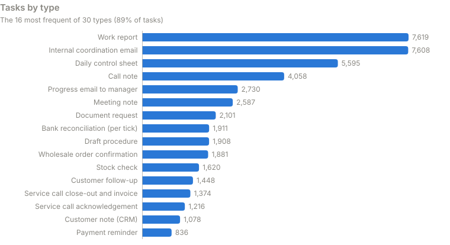

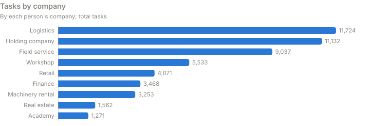

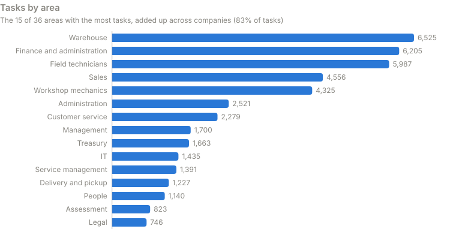

The roles with the most tasks are field technician (5,987), warehouse operative (4,923), workshop mechanic (4,325), sales rep (3,464) and cash-pool treasurer (2,231).

### The texts

Every task leaves a text in its app. Of the 51,051, **37,563** (74%) were written by the model at the first attempt, **7,021** (14%) after a retry with the reasons for the rejection, and **6,467** (13%) are the fixed template for their type, which is used when the model fails twice.

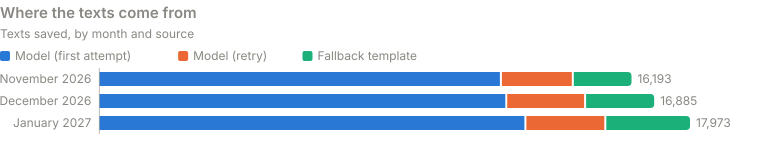

The validator logged **19,466 rejection reasons**. The most frequent are technical: a required placeholder is missing (9,776), a reference unrelated to the task appears (4,767) or the text is too short (2,807). The privacy rules also kick in: there were 699 rejections for naming someone in the census and 65 for health or emotion vocabulary, and none of those texts was saved.

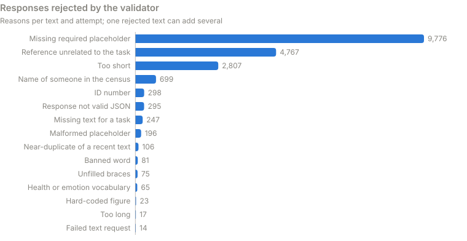

## How it all links together

Nothing happens in isolation. Events that move money leave their entry in the books of the companies involved and, depending on the case, documents in the ERP and transactions in the bank; the others (an order drafted or approved, a delay, a reminder, a customer flagged as delinquent) carry no entry. Nine kinds of event, the ones in the table [below](#from-event-to-task), also create a task for someone with the right role, company, app and, where needed, approval limit: in the next tick or, if nobody has room, first thing on the next day with someone available. Bank transactions are grouped in batches, so many of them produce a single task.

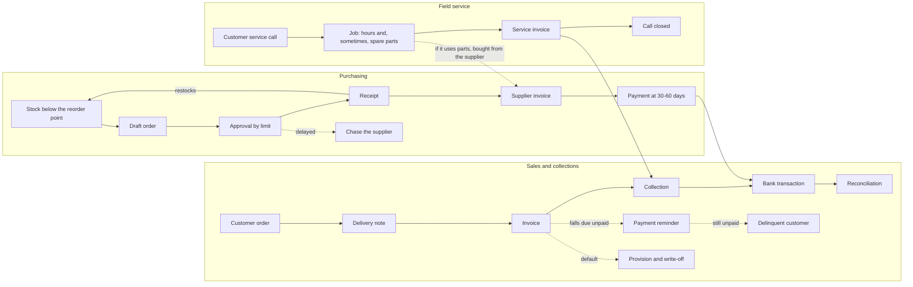

- **Sale → invoice → collection → bank → reconciliation.** The shop is paid up front through the payment gateway, which settles the receipts in a single transaction per tick; business customers pay at 30, 45 or 60 days, and some pay late. Every bank transaction goes into the reconciliation task of its company's treasury or of the cash pool. If an invoice falls due unpaid, treasury chases it; if the delay continues, the sales rep follows up the delinquent customer. Among invoices that stay with the selling company, only those that end up unpaid are provisioned: 50% at 20 days past the due date, and at 60 days they are written off. Invoices sold through factoring are provisioned by the finance company by age, on the same schedule, and the provision is reversed if they are collected in the end.
- **Low stock → purchase order → approval → receipt → supplier invoice → payment.** Items that end a tick below their reorder point come out as drafts in the next one; the economy then assigns the approval to someone with a limit for that amount and, in the next tick, the task reaches them. If the supplier is late, purchasing chases them. Receipt increases inventory and records the supplier's invoice, which is paid on its terms.
- **Service call → repair → invoice.** The day's service calls reach the field technician, who acknowledges them to the customer. In the economy, each job uses hours and sometimes spare parts (bought from the supplier) and is invoiced; in the next tick, field service administration closes the call and its invoice. Maintenance contracts add monthly fees.
- **Taxes, payroll and structure.** Payroll is paid on the last working day of each month and the extra pay in December; Social Security is settled every month, VAT and income tax withholding every quarter, and corporate income tax is accrued at each month-end.

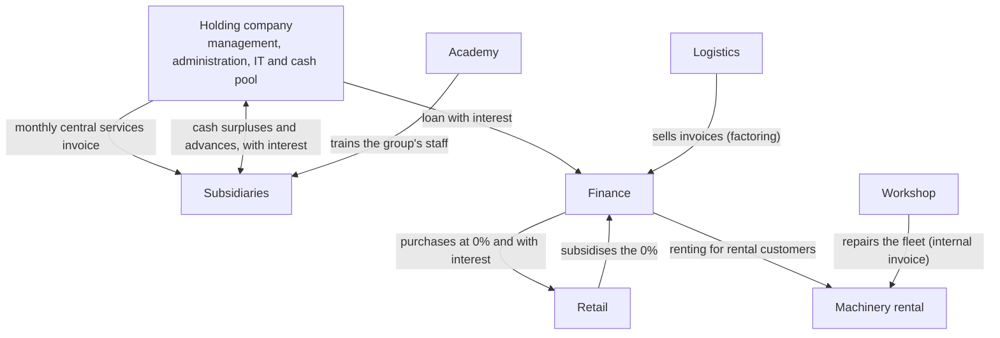

- **Central services:** every month the holding company invoices the eight subsidiaries for the group's management, administration and IT.
- **Cash pool:** the subsidiaries deposit their surpluses with the holding company and receive advances when a tick leaves their cash negative; balances earn daily interest both ways.
- **Finance:** it finances retail purchases at 0% (retail pays the subsidy) or with interest, buys logistics invoices at 30-60 days (non-recourse factoring), provides renting to machinery customers and personal loans, and is funded by a loan from the holding company and a bank credit line.
- **Workshop ↔ machinery rental:** breakdowns in the rental fleet go to the workshop, which issues an internal invoice; the machine is out of service for a few days.
- **Academy:** besides its own students, it trains the group's staff in February, May and October with internal invoices; none of those sessions falls within this run.

All these internal transactions appear in both companies for the same amount and are eliminated on consolidation (see the economy, below).

### From event to task

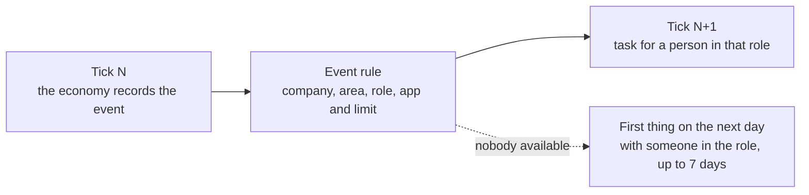

| Event in the economy | Task it creates | Who gets it (main roles) | Events | Tasks | Same day | Median delay |
|---|---|---|---:|---:|---:|---:|
| Bank transaction | Bank reconciliation | cash-pool treasurer, treasury, finance company treasury | 17,329 | 1,911 | 54% | 1 h 59 min |
| Field service invoice | Close-out and invoice of the call | field service administration, field service planning, head of field service | 1,374 | 1,374 | 76% | 1 h 38 min |
| Overdue unpaid invoice | Payment reminder | cash-pool treasurer, accounts receivable | 836 | 836 | 49% | 15 h 50 min |
| Purchase order awaiting approval | Order approval | managing director, finance director, buyer | 416 | 416 | 84% | 1 h 35 min |
| Workshop invoice | Repair close-out | workshop manager | 206 | 206 | 81% | 1 h 38 min |
| Customer flagged as delinquent | Delinquent customer follow-up | sales rep, key account manager, sales administration | 133 | 133 | 50% | 14 h 25 min |
| Academy invoice | Enrolment | administration | 106 | 106 | 81% | 1 h 41 min |
| Late purchase | Chase the supplier | buyer, head of purchasing | 61 | 61 | 70% | 2 h 10 min |
| Budget variance at month-end | Variance review | managing director, company manager, training coordination | 18 | 18 | 0% | 15 h 54 min |

Bank transactions are reconciled in batches. Whatever happens late in the day, at the weekend or at month-end moves to first thing on the next working day, hence median delays of up to about 16 hours.

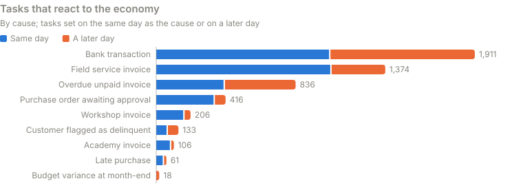

On top of that, the seed's daily events are handed out by fixed rules: 1,881 wholesale orders go to sales reps, 4,572 online orders are summarised in 604 customer service and catalogue tasks, 1,216 service calls go to field technicians, 1,617 supplier invoices are entered in 429 accounts payable and accounting tasks and 3,286 bank transactions are reconciled in 358 treasury tasks.

### Complete chains

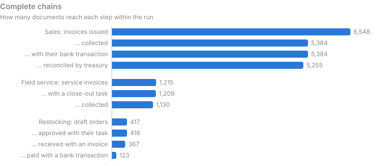

- **Logistics and retail sales:** 6,548 invoices, all with the delivery note of their order; 5,384 collected, all with their bank transaction, and 5,255 of those transactions already reconciled by treasury. That makes **5,255 complete chains** (80%); for the rest, the invoice has not been collected yet or its transaction is waiting for reconciliation.
- **Field service:** 1,215 service invoices, 1,209 with their close-out task and 1,130 collected (1,097 reconciled).
- **Restocking:** 417 draft orders, 416 approved with their task, 367 received with the supplier's invoice and **123 paid** with their bank transaction: the whole chain from low stock to payment. The rest are waiting for the payment due date (244) or delivery (50).
- **Other chains:** the workshop issued 182 invoices (181 with their close-out and 80 collected, because its customers pay on terms) and 26 internal invoices to machinery rental; the academy, 106 invoices with their 106 enrolments, all collected; machinery rental, 1,218 rental invoices with 842 collected. Field service and the workshop bought materials in 1,018 orders received on the spot, of which 434 have already been paid.

## The run's economy

Revenue by company and month, in rounded euros.

| Company | November | December | January |
|---|---:|---:|---:|
| Holding company | €123,333 | €123,333 | €123,333 |
| Logistics | €2,828,533 | €2,689,508 | €3,196,576 |
| Retail | €1,579,922 | €1,546,077 | €1,708,281 |
| Field service | €99,485 | €109,568 | €107,815 |
| Workshop | €135,345 | €122,953 | €133,419 |
| Machinery rental | €59,296 | €44,709 | €42,737 |
| Academy | €27,719 | €8,570 | €10,123 |
| Finance | €30,788 | €188,567 | €195,160 |
| Real estate | €45,559 | €50,972 | €44,250 |
| Sum of companies | €4,929,980 | €4,884,257 | €5,561,695 |
| Intragroup eliminations | −€154,683 | −€159,402 | −€167,166 |
| **Consolidated group** | **€4,775,297** | **€4,724,855** | **€5,394,529** |

Pre-tax profit by company and month:

| Company | November | December | January |
|---|---:|---:|---:|
| Holding company | €44,356 | −€26,172 | €13,032 |
| Logistics | €140,334 | €61,059 | €239,763 |
| Retail | €94,582 | €56,076 | €120,286 |
| Field service | €14,375 | −€17,952 | €12,727 |
| Workshop | €20,152 | −€24,484 | €11,608 |
| Machinery rental | €14,497 | −€26,207 | −€17,871 |
| Academy | €8,906 | −€13,868 | −€5,755 |
| Finance | −€24,216 | €107,386 | €115,679 |
| Real estate | €16,125 | €8,768 | €10,684 |
| **Consolidated group** | **€329,112** | **€124,606** | **€500,154** |
| Corporate income tax | €88,332 | €31,243 | €130,945 |
| **Group result** | **€240,780** | **€93,363** | **€369,209** |

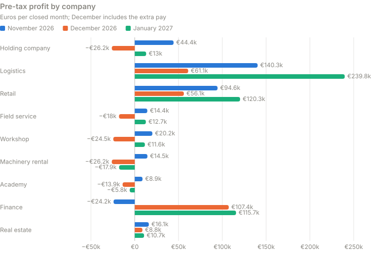

December includes the extra pay: the holding company, field service, the workshop, machinery rental and the academy close the month at a loss. Intragroup eliminations match their counterpart to the cent: in November, €110,000 of central services, €14,957 of 0% finance subsidy, €13,333 of interest on the holding company's loan, €8,748 of factoring discount, €6,760 of cash-pool interest and €886 of workshop repairs to machinery rental. The consolidated result does not change when they are eliminated.

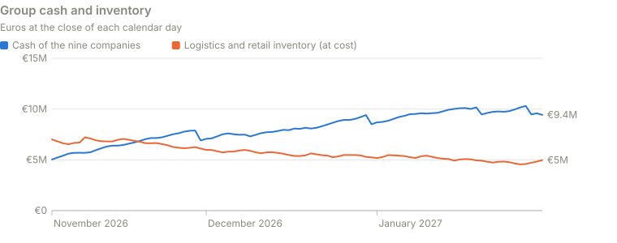

- **Cash:** across the nine companies it goes from €4,891,000 to €9,434,722; the holding company's cash pool holds €9,157,572 and the subsidiaries keep small balances.
- **Inventory:** logistics and retail inventory falls from €7,178,352 to €4,972,662 at cost, with 23,317 units at the end.
- **Unserved demand:** logistics left 57 units unserved (€14,811.70; it served 99.8% of what was ordered) and retail 181 (€15,922.83; 98.9%). The queue of orders waiting for stock peaked at 74 units and the queue of technical jobs at 7; on 31 January, 1 call was still open at field service and 0 jobs at the workshop.
- **Finance:** 816 retail purchases at 0% (€1,107,858.23), 264 with interest (€368,989.02), 18 personal loans (€1,260,000) and 6 renting deals (€900,000), all granted within the run (the starting portfolio of 285 personal loans and 20 renting deals is counted separately); 629 logistics invoices sold through factoring for €3,384,133.29, of which €1,422,750.43 has already been collected.
- **Payroll and taxes in the bank:** 27 payroll payments (€604,972.84), 9 extra-pay payments (€211,414), 18 Social Security settlements (€212,237.68), 9 income tax withholding payments (€68,482.80) and 11 VAT transactions (€718,442.85 paid and €9,368.41 received).
- **Other:** 10 active machinery rentals and 22 occupied properties at the end of the period.

## An ordinary day

**Monday 16 November 2026** was the working day closest to the average (837 tasks against 837).

- **People and tasks:** 146 people worked in 75 roles. Tasks were split across email (285), documents (259), spreadsheets (103), phone (57), bank (53), ERP (48) and CRM (32). The most frequent were work reports (133), internal coordination emails (123), daily control sheets (86), call notes (57), bank reconciliations (47) and progress emails to managers (46).
- **Reactions to the economy:** 98 tasks: 47 bank reconciliations, 20 academy enrolments, 14 service call close-outs, 5 workshop repair close-outs, 5 purchase order approvals, 4 late-delivery chases to suppliers, 2 payment reminders and 1 delinquent customer follow-up.
- **Economy:** 11 one-hour ticks with 606 events, mostly per-sale costs of online orders (228), retail and wholesale sales (112), loans and financed purchases (50), cash-pool sweeps and advances (42) and academy courses (25). 177 invoices were issued for €280,988.88, there were 157 bank transactions (20 of them customer receipts) and group cash went from €6,397,999 to €6,471,516. Retail left 5 units unserved.
- **Two chains:** a field service invoice issued in the 07:00 tick reached field service administration at 08:11 as a close-out task, and it has been collected. A retail purchase order that went to approval in the 16:00 tick reached the finance director at 17:07 as a task; that role has the approval limit for the amount.

## Earlier tests

These figures come from runs and tests before the three-month run.

- **Size:** 154 synthetic people, nine companies and about 20 rooms.
- **Activity:** one test day generated **800 tasks**. A longer run produced **15,310 tasks over 19 working days**, about **806 per working day** on average.
- **Pace:** that run produced **25 simulated calendar days in 10.9 real hours**, about **55 simulated days per real day** with that setup.
- **Automated tests:** a later suite for the economy and the working days completed **389 tests**, with no failures and none skipped.

A simulated full-year run gave the following figures by company. Amounts include transactions between companies, and the results reflect costs and depreciation, before and after corporate income tax. Revenue should not be added up without eliminating internal transactions.

| Company | Revenue | Pre-tax profit | Profit after tax |
|---|---:|---:|---:|
| Holding company | €1,496,558.32 | €69,065.61 | €51,799.21 |
| Logistics | €36,400,932.16 | €1,495,767.20 | €1,121,825.40 |
| Retail | €19,696,429.71 | €1,045,503.76 | €784,127.82 |
| Field service | €1,315,754.81 | €123,443.20 | €92,582.40 |
| Workshop | €1,619,370.01 | €92,421.75 | €69,316.31 |
| Machinery rental | €762,733.25 | €44,821.54 | €33,616.15 |
| Academy | €262,804.93 | €21,087.20 | €15,815.40 |
| Finance | €2,310,019.13 | €1,070,085.36 | €802,564.02 |
| Real estate | €564,017.77 | €149,244.42 | €111,933.31 |

## Privacy and red lines

The people, organisations and data in AAOS are synthetic. Ariamir is designed to help with work, not to monitor people.

- It does not score or profile people and does not make employment decisions.
- Any text that puts a person or role placeholder in the same sentence as a term from the health vocabulary is rejected without exception, even when negated. It is a text rule, not a general understanding of language.
- It does not use cameras or biometrics, and it does not infer emotions.
- Its scope must be visible and limited to the role and the authorised purpose.
- The person must be able to switch the assistant off.

The figures in this document are counted by role, area and company, never by person. Some roles, such as the cash-pool treasurer, the managing director or the workshop manager, are held by a single synthetic person, so their figures are that person's.

## Status

- The simulated group, the working days, text generation and the tick-based economy are built, with automated tests.
- The code went through six rounds of independent audit and was closed except for a minor robustness detail when resuming, with no effect on the data. The long run with the audited code reached 31 January 2027; this document covers all its days.
- Tasks that come from the seed's daily events are not yet linked to the documents of the tick-based economy: their references do not appear in the run's ERP or bank.
- Ariamir's full connection to the apps, its permissions and its effects over a working day still have to be verified.
- A tool bench for Ariamir on the simulated days is under construction; it has no results yet.
- A measurement campaign is still needed that compares working days with and without help and records usefulness, failures and compute cost.
- A collaboration with a supercomputing centre is being considered to extend and repeat the experiments; it is a proposal, not a result.

## How the figures are regenerated

```
node tools/estadisticas.mjs --tanda <run folder> --censo <people census> --lang en
```

The script only uses Node. It reads the days that have a complete manifest and follow on from the first one, checks the fingerprint of every file and rewrites `tools/datos.json`, the charts in `img/datos-en/` and this document (as the draft `README.en-borrador.md`; `node tools/readme-en.mjs --readme README.md` writes it straight here from `tools/datos.json`). The census is required, and only each person's company and area are taken from it; without it, the script stops with a warning and writes nothing, so the charts by company and area linked here are never missing. `--hasta YYYY-MM-DD` stops at a given day. Field names in `tools/datos.json` are in Spanish.

---

The project code is in a private repository of the organisation. AAOS and Ariamir are built with the help of AI agents and of Ariamir itself.
