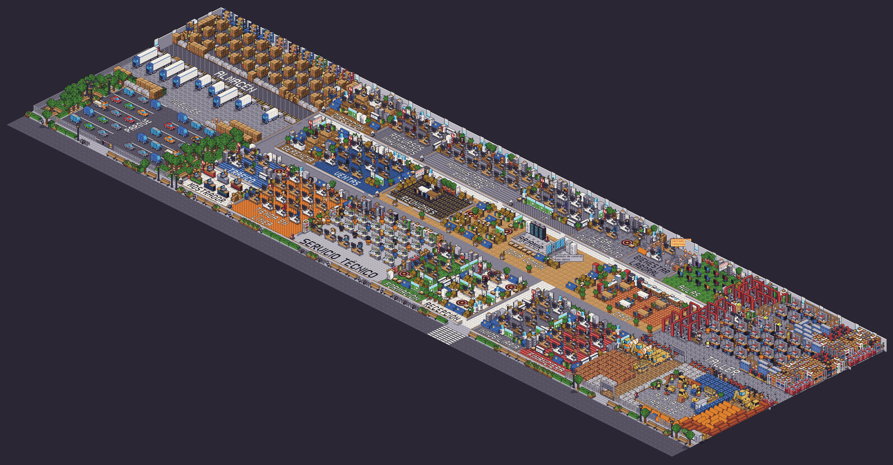
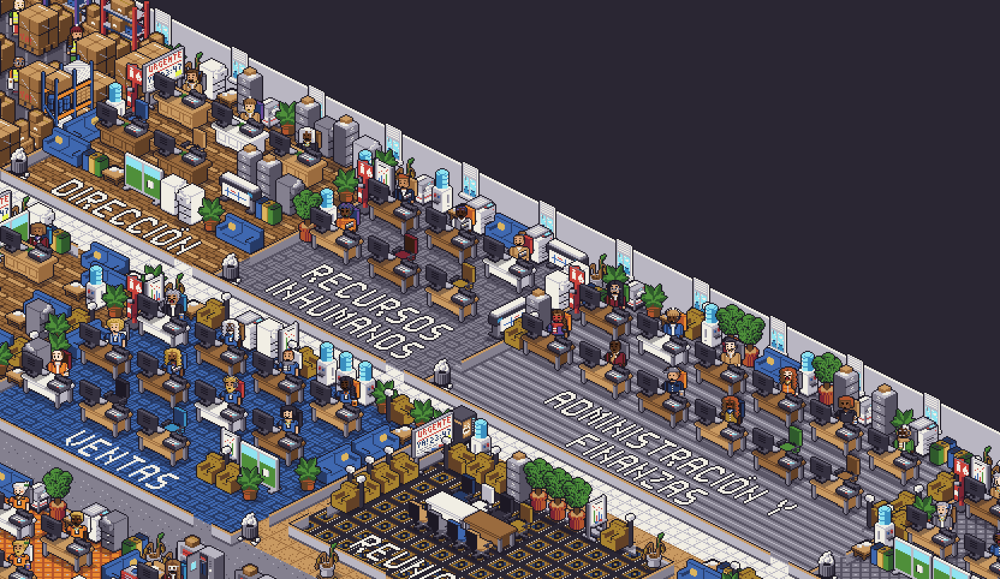
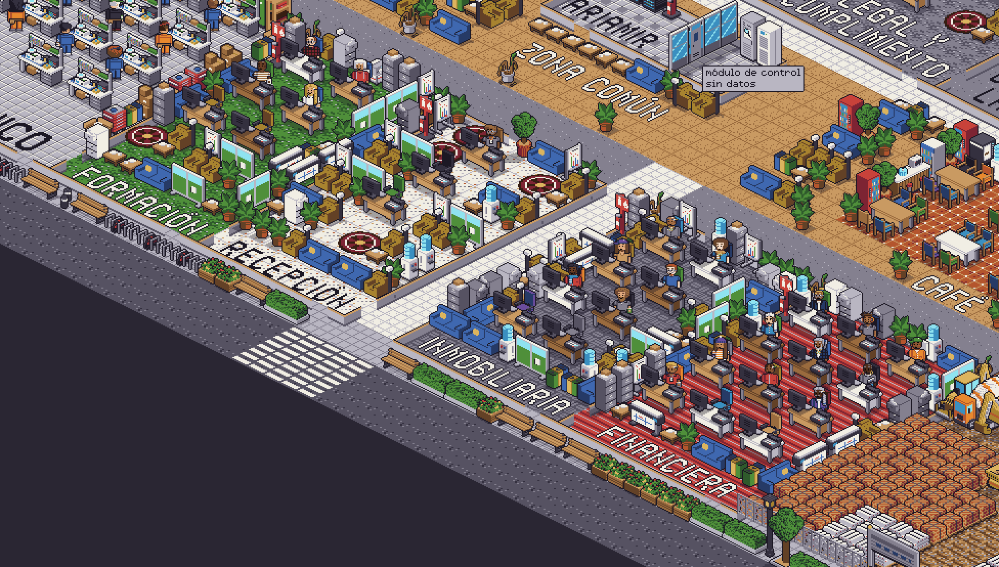
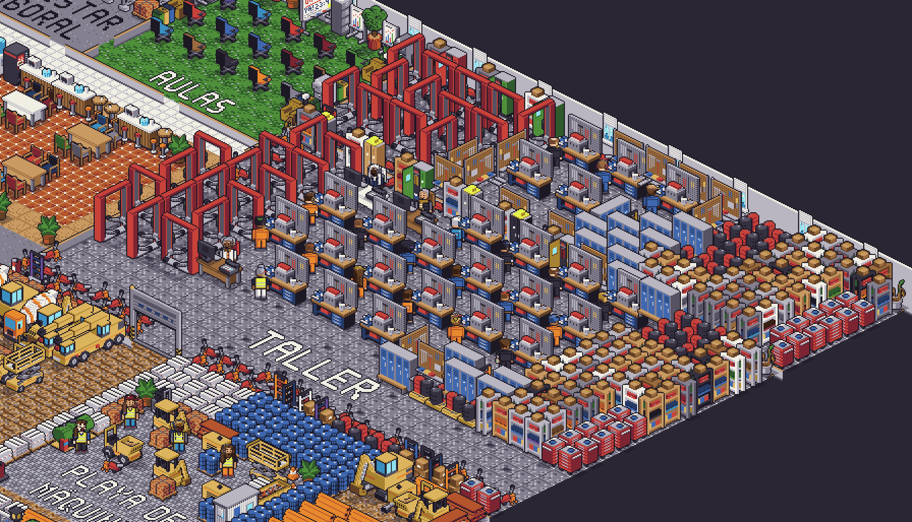
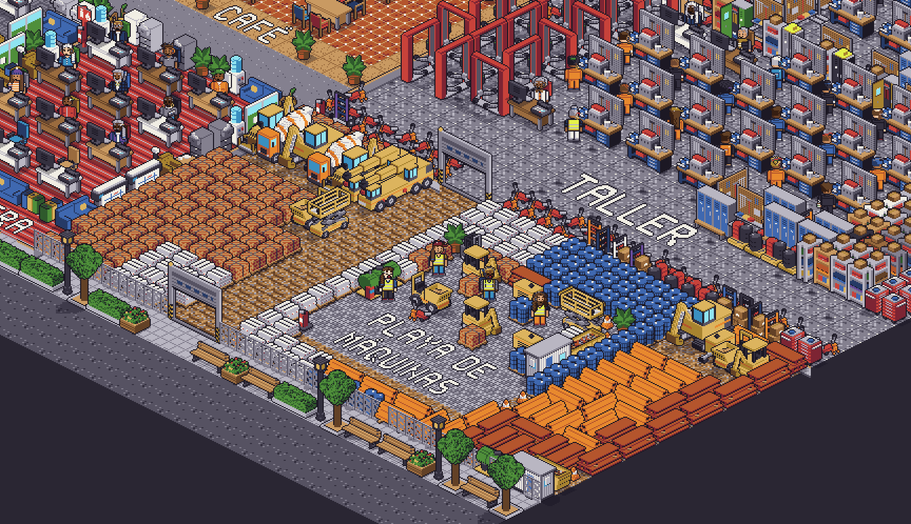
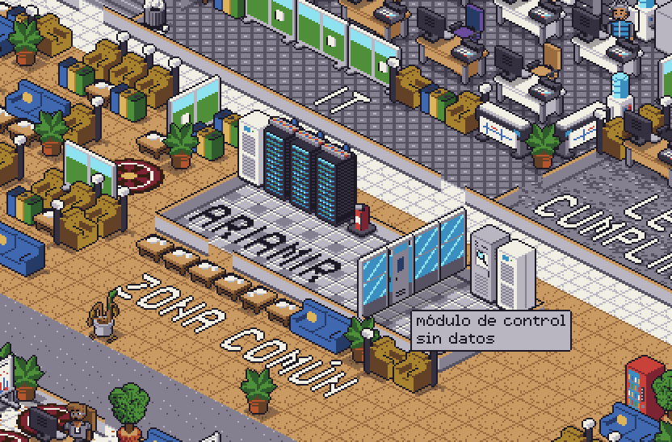

# AAOS — Empresa virtual de entrenamiento

AAOS es una empresa virtual **simulada** que sirve de gimnasio y banco de pruebas para Ariamir, un asistente de IA local y privado que utiliza herramientas. La empresa genera jornadas, documentos y operaciones para que Ariamir pueda ayudar desde un puesto concreto y ser evaluado en un entorno reproducible.

*Vista general de la empresa simulada.*

## Por qué existe

Usar herramientas de oficina exige algo más que responder preguntas: un asistente debe entender una tarea, consultar la información adecuada y actuar dentro de sus permisos. AAOS permite entrenar y medir esas capacidades en un entorno de trabajo realista y reproducible, sin utilizar datos de personas reales.

El objeto de la evaluación es **Ariamir**. AAOS aporta el contexto y las tareas con las que ponerlo a prueba.

## Cómo funciona

### Un grupo simulado

AAOS representa un grupo de varias sociedades, con **154 personas sintéticas** y unas **20 salas**. Sus actividades abarcan comercio, logística, servicios técnicos, taller, formación, maquinaria, financiación e inmobiliaria.

*Espacios de trabajo de las distintas áreas.*

### Jornadas y herramientas

Cada persona tiene una agenda generada según su puesto y los programas que utiliza. Las tareas dejan actividad en herramientas como correo, documentos, hojas de cálculo, CRM, ERP, banco y teléfono.

*El frente comercial forma parte de la actividad diaria del grupo.*

### Textos con contexto

Un modelo local, ejecutado en una GPU propia, redacta correos y documentos a partir de las tareas y sus datos. Un validador de reglas comprueba los textos generados.

### Una economía que avanza por horas

La simulación económica avanza por intervalos y utiliza contabilidad por partida doble. Representa existencias, compras, cobros y pagos, nóminas, impuestos, presupuestos y cuentas de resultados. El ERP recoge operaciones y sus estados.

Las operaciones entre sociedades se registran en ambas partes y se eliminan al céntimo al consolidar el grupo.

*El taller genera trabajos, consumo de materiales y actividad económica.*

*La actividad de maquinaria también tiene reflejo en la economía simulada.*

### Ariamir en su asiento

Ariamir se sitúa en un puesto y ayuda a su titular con las herramientas y la información que llegan a ese escritorio. Su alcance se define por el asiento y los permisos correspondientes. La conexión completa con las aplicaciones y su ayuda efectiva durante una jornada están pendientes de acreditación.

*La infraestructura local sostiene el entorno de simulación.*

## Cifras

Las cifras describen ejecuciones y pruebas concretas de la simulación; no son resultados de una empresa real ni una medida de la ayuda prestada por Ariamir.

- **Tamaño:** 154 personas sintéticas, nueve sociedades y unas 20 salas.
- **Actividad:** una jornada de prueba generó **800 tareas**. En una tanda más larga se produjeron **15.310 tareas en 19 días con trabajo**, unas **806 por día trabajado** de media.
- **Ritmo:** esa tanda produjo **25 días naturales simulados en 10,9 horas reales**, equivalentes a unos **55 días simulados por día real** bajo esa configuración.
- **Pruebas automáticas:** una batería posterior de la economía y las jornadas completó **285 pruebas**, sin fallos ni pruebas omitidas.

Una ejecución anual simulada arrojó las siguientes cifras por sociedad. Los importes incluyen operaciones entre sociedades y los resultados son **antes del impuesto sobre sociedades**, tras gastos y amortizaciones. No deben sumarse los ingresos sin eliminar las operaciones internas.

| Sociedad | Ingresos | Resultado antes de impuestos |
|---|---:|---:|
| Matriz | 1.496.558,32 € | 69.065,61 € |
| Logística | 36.400.932,16 € | 1.495.767,20 € |
| Tienda | 19.696.429,71 € | 1.045.503,76 € |
| Servicio técnico | 1.315.754,81 € | 123.443,20 € |
| Taller | 1.619.370,01 € | 92.421,75 € |
| Maquinaria | 762.733,25 € | 44.821,54 € |
| Academia | 262.804,93 € | 21.087,20 € |
| Financiera | 2.310.019,13 € | 1.070.085,36 € |
| Inmobiliaria | 564.017,77 € | 149.244,42 € |

## Privacidad y líneas rojas

Las personas, organizaciones y datos de AAOS son sintéticos. Ariamir está concebido para ayudar en el trabajo, no para vigilar a las personas.

- No puntúa ni perfila personas y no decide medidas laborales.
- No utiliza cámaras ni biometría, y no infiere emociones.
- Su alcance debe ser visible y limitado al puesto y a la finalidad autorizada.
- La persona debe poder desactivar el asistente.

## Estado

- Están construidos el grupo simulado, las jornadas, la generación de textos y la economía por intervalos, con pruebas automáticas.
- La auditoría dio lugar a correcciones comprobadas localmente. Quedan pendientes la revisión independiente, la aceptación de la auditoría y la integración de esos cambios.
- La conexión completa de Ariamir con las aplicaciones, sus permisos y sus efectos en una jornada todavía deben acreditarse.
- Falta una campaña de medida que compare jornadas con y sin ayuda y registre la utilidad, los fallos y el coste de cómputo.
- Se plantea colaborar con un centro de supercomputación para ampliar y repetir los experimentos; es una propuesta, no un resultado ya obtenido.

---

El código del proyecto está en un repositorio privado de la organización. AAOS y Ariamir se construyen con ayuda de agentes de IA y del propio Ariamir.